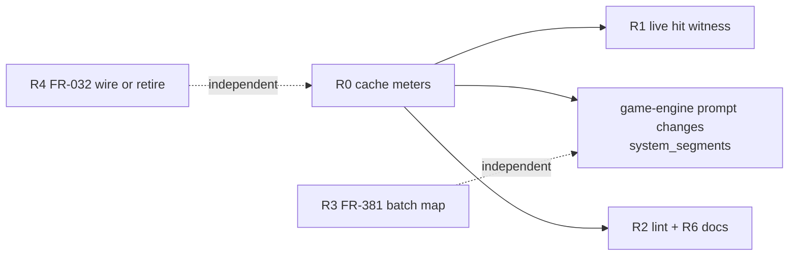

# Research: Prompt Caching in YAMLGraph — Anthropic API, LangGraph Cache, Game-Engine Consumer

*2026-11-12. Read-only research; no code changed, no paid API call made.*

Sources:
- Anthropic docs: <https://platform.claude.com/docs/en/build-with-claude/prompt-caching>
- LangGraph Graph API docs (node caching section)
- YAMLGraph code (cited below with paths)
- Game-engine consumer analysis: `C:/src/game-engine/docs/2026-11-12-sonnet-cache-cost-analysis.md` (brief 441), which
  measured 280 run records / 611 graph runs and dumped request payloads through `langchain_anthropic`

Grades: **[A]** read in code, docs or a committed record; **[M]** model estimate or judgement.

## 1. Conclusion first

1. **YAMLGraph's prompt caching works on the wire today, but only for system segments, only at 5-minute TTL, and is
   invisible in usage accounting** [A]. The invisibility is the defect: `TokenUsageCallbackHandler` sums
   `usage_metadata["input_tokens"]`, which `langchain_anthropic` already reports as `input + cache_read +
   cache_creation`. A cached run is therefore priced at full input rate and no one can tell a hit from a miss.
2. **The first and only must-do is the cache meter (R0).** Every other caching decision is unmeasurable without it.
3. **For the only real consumer (game-engine), caching is worth 5–13 % of the Sonnet bill (~$0.2–0.5/book)** [M,
   game-engine analysis]. Output is 50–65 % of spend and caching only reprices input. The game-engine changes need
   **no new YAMLGraph feature** — `system_segments` + `cache: true` covers every profitable case.
4. **The biggest cost lever is batching (FR-381, Proposed), not caching** — ~$0.1–1.3/book on the library fan-out alone.
5. **LangGraph node `cache:` (FR-032) is a different thing and is inert**: it memoizes node results, never touches the
   request, and YAMLGraph compiles without a `cache=` backend. It should be either wired or retired, not left as a
   phantom claim.
6. **Not needed now:** user-message breakpoints, 1-hour TTL, top-level automatic caching, tool breakpoints. Each lacks a
   consumer whose reuse falls outside what system segments + 5 m already deliver.

## 2. Anthropic prompt caching — the facts that matter for YAMLGraph [A, docs]

| Fact | Consequence for YAMLGraph |
|---|---|
| Prefix order is `tools` → `system` → `messages`; a change at any level invalidates it and everything after | Stable material must precede volatile material. Segment order in prompt YAML is a cost decision |
| A cache **write happens only at a breakpoint**; lookback (≤ 20 blocks) finds only entries written by earlier requests | A breakpoint on a varying block writes every call and never reads. `cache: true` must sit on the *last stable* segment |
| Max 4 breakpoints per request | Lint should cap `cache: true` segments at 4 |
| Minimum cacheable prefix: 512 tokens (Opus/Sonnet 5.5, Opus/Sonnet 5, Haiku 5.5); 1,024 (Sonnet 4.5/4.6, Opus 4.8); 2,048 (Opus 4.7); 4,096 (Opus 4.5/4.6, **Haiku 4.5**) | Below the minimum, caching silently does nothing — no error. YAMLGraph's default Anthropic model is `claude-haiku-4-5` (`yamlgraph/config.py`), so default-model graphs almost never cache |
| Pricing: 5 m write 1.25×, 1 h write 2×, read 0.1× (0.05× on Opus/Sonnet 5.5; 0.025× on Fable/Mythos 5.1+) | Sonnet 5.5 break-even: one read pays for ~3.8 writes (0.95 / 0.25). Reuse rate ≥ 26 % pays |
| TTL measured from request **start**, refreshed free on each read | Long generations eat the 5 m window; loops with > 5 m per turn need `1h` |
| Entry readable only after the first response **starts** | In a `map` fan-out of N concurrent calls, the first wave all write. "Warm one, then fan out" or `max_tokens: 0` pre-warm removes that |
| Mixing TTLs: longer TTL must come first | A top-level `1h` automatic breakpoint after a `5m` block breakpoint is rejected (400). Any TTL feature must lint this |
| Automatic caching: one top-level `cache_control`; breakpoint moves to last cacheable block | Fits growing conversations; wrong for static-prefix + varying-suffix prompts (it lands on the varying block) |
| Invalidators beyond text: tool definitions, `tool_choice`, images, thinking config, `effort`, speed | Per-node thinking/effort must stay fixed across retries of the same node to keep the cache |
| Usage fields: `cache_read_input_tokens`, `cache_creation_input_tokens`, `cache_creation.ephemeral_5m/1h_input_tokens`; `input_tokens` is only the post-breakpoint tail | Total input = read + creation + input. Accounting must price the three meters apart |
| Batch API: caching best-effort; discounts stack | Batching and caching compose |

## 3. YAMLGraph today [A]

### 3.1 Prompt caching (FR-276, FR-219, FR-1055; CAP-131)

- `prepare_messages` ([yamlgraph/executor_base.py](../yamlgraph/executor_base.py)) builds `[SystemMessage,
  HumanMessage]`. `system_segments` (or list-form `system:`) go through `_build_system_message_from_segments`.
- For provider `anthropic`, each segment becomes `{"type": "text", "text": ...}`; `cache: true` adds
  `cache_control: {"type": "ephemeral"}`. FR-1055 moved the blocks into `SystemMessage.content` (they were previously
  dropped by `langchain_anthropic`). Other providers get one joined string.
- The user message is always a single string — **no user-message breakpoint**.
- **No TTL option**; always provider default (5 m).
- **No top-level automatic caching** option.
- Game-engine's request dump confirms `langchain_anthropic` 1.7.0 passes system `cache_control`, message-level
  content-block `cache_control`, a call-kwarg top-level `cache_control`, and `ttl` through unchanged. YAMLGraph is the
  only gate.
- Tests: `tests/unit/test_prompt_caching_fr276.py` (segment parsing, Anthropic blocks, flattening, async parity, the
  FR-1055 formatter seam); `tests/unit/test_prompt_caching_demo_fr219.py` (shape only). **No live cache-hit witness
  exists** — FR-1055 records live verification as blocked and the FR-219 demo's prefix as below minimum.

### 3.2 Usage accounting

[yamlgraph/utils/token_tracker.py](../yamlgraph/utils/token_tracker.py) sums `input_tokens`, `output_tokens`, and
`output_token_details.reasoning` (FR-1152). It ignores `input_token_details.cache_read` / `cache_creation` /
`ephemeral_5m_input_tokens` / `ephemeral_1h_input_tokens`, which `langchain_anthropic._create_usage_metadata` already
provides. Downstream consumers (game-engine `run.py`, `chapter_music.py`, `character_map.PRICE`) parse the
`Token usage: N in / M out` line with regexes and price `N` at full input rate.

### 3.3 LangGraph node cache (FR-032)

- Node YAML `cache: true | {ttl: N}` → `CacheConfig` ([yamlgraph/models/guard_schema.py](../yamlgraph/models/guard_schema.py))
  → `CachePolicy(ttl=...)` passed to every `add_node` ([yamlgraph/compile/node_compiler.py](../yamlgraph/compile/node_compiler.py)).
- `compile()` receives a checkpointer but **no `cache=` backend** (`executor_async.py`, `cli/graph_commands.py`), so the
  policy is inert. FR-032 records "Implemented — inert"; `tests/unit/test_fr1065_resumable_map_probes.py` pins that.
- Semantics when wired: memoize a node's state update keyed by a hash of its input (`key_func`), stored in
  `InMemoryCache` / `SqliteCache`. It skips the LLM call entirely on an identical input. It is **not** prompt caching
  and does not interact with Anthropic's cache.
- Other caches: `GRAPH_CACHE` (compiled graphs, in-process), `llm_factory` client memoization. No `set_llm_cache`.

### 3.4 YAMLGraph's own game-like graphs

- `examples/npc/encounter-*.yaml`: 3–5 LLM stages per turn; scalar system prompts ≈ 150–200 tokens [M, chars/4].
- `examples/dungeon_master/turn.yaml`: character-intent map + director + recap; system ≈ 400–950 tokens [M].
- None use `system_segments`. All are under the 4,096 Haiku 4.5 minimum (the default model); only the director would
  cross 512 on a 5.5-generation model. **No caching value here** unless world state moves into a cached segment.

## 4. The consumer: game-engine (brief 441 summary)

The game-engine analysis is the evidence base; its key findings, checked against YAMLGraph code here:

| Finding | Verified here |
|---|---|
| No game-engine prompt uses `system_segments`; all scalar `system:` / `user:` | consistent with YAMLGraph having no other caching path [A] |
| Output = 50–65 % of Sonnet dollars; caching can't touch it | [A, their run records] |
| Profitable reuse is all within minutes: library describe fan-out (9–140 calls), text round 2, fix after judges, embellish plan retry | → 5 m TTL suffices; no 1 h consumer |
| Every profitable case is reachable with `system_segments` by moving shared material (chapter block, title/setting) into a cached system segment and feedback into the user message | → no user-message breakpoint needed now |
| Token tracker overstates cached runs and hides hits | [A, §3.2] |
| Batching the library describe map: ~$0.1–1.3/book, largest lever | FR-381 is **Proposed**; game-engine is its first named consumer |

Ranked game-engine savings (per book, Sonnet 5.5): batching library $0.08–1.31; library system cache $0.19–0.34 on long
books (−$0.01 on short); shared chapter block for adapt/fix/round 2 $0.05–0.3; embellish retry cache ~$0.17 where
retries ≥ 26 %.

## 5. Recommendations for YAMLGraph

Ranked by (consumer value × certainty) / cost. Each is an FR before code (doctrine).

### R0 — Cache meters in the token tracker (**do now**; small; prerequisite)

- `TokenUsageCallbackHandler` additionally sums `input_token_details.cache_read`, `cache_creation`,
  `ephemeral_5m_input_tokens`, `ephemeral_1h_input_tokens`; `summary()` returns them.
- Summary line keeps its existing prefix so current regexes still parse, and appends cache fields, e.g.
  `Token usage: N in (R cache read, W cache write) / M out`. Document that `N` is **total** input (read + write +
  uncached), matching `langchain_anthropic`.
- Witness: unit test with a fake `usage_metadata` carrying `input_token_details` (no API call); a second test that the
  line still matches the old `N in / M out` pattern.
- Unblocks: honest pricing in game-engine records; the FR-1055 live-hit witness; every later decision.

### R1 — Live cache-hit witness (**do with R0**; ~$0.05)

- One integration test (API-key guarded, `@pytest.mark.req`) sending the same > 512-token cached segment twice on a
  5.5-generation model; assert second call's `cache_read > 0`. Closes FR-1055's blocked verification. Name it after the
  seam (`test_anthropic_system_segment_cache_read_live`).

### R2 — Prompt linter checks for caching (**small; after R0**)

- `cache: true` count ≤ 4 per prompt (API hard limit → 400).
- Warn when a cached prefix is likely below the model minimum (chars/4 estimate against a per-model table; warn, not
  error — the estimate is approximate and the API fails silently).
- Warn when `cache: true` is set on the **last** segment and that segment's template references per-call variables
  (feedback, findings): the "breakpoint on a varying block" mistake from the docs.
- Warn when the resolved provider is not Anthropic (flags are ignored).

### R3 — Batch mode for `map` LLM nodes (FR-381; **medium; highest dollar value**)

- Re-judge FR-381 with game-engine's library describe map as first consumer and its numbers as the value proposition.
- Keep caching orthogonal: segments with `cache: true` pass through to batch requests unchanged; recommend the docs'
  pattern (one 1 h-cached request first, then the rest) only if a consumer shows batch cache misses.

### R4 — Resolve FR-032 node cache: wire or retire (**decision FR; small either way**)

- Inert config is a phantom claim (`growth_as_default`, `detection_without_enforcement`). Two options:
  - **Wire:** graph-level `cache: {backend: memory|sqlite, path: ...}` passed to `compile(cache=...)`. Real uses:
    deterministic re-runs (dev loops, lint/smoke, census re-runs per FR-1031). Must define `key_func` over the node's
    *rendered* inputs, not whole state, or every turn misses.
  - **Retire:** remove `cache:` from node schema and `CachePolicy` plumbing; record removal in commit notes.
- Game-engine provides **no** consumer: each round runs in a new process and its inputs differ by design (feedback).
  Absent a named consumer, lean **retire**.

### R5 — Deferred, with the trigger that would revive each

| Feature | Revive when |
|---|---|
| `user_segments` / list-form `user:` with `cache` (HumanMessage content blocks) | A consumer must keep instructions in `system` and still cache a large shared block that varies per node *after* them — i.e. the system-segment workaround forces an order that fails a fidelity replay |
| `cache: {ttl: 1h}` on segments | A measured reuse gap of 5–60 min (e.g. human-paced interrupt loops, long generations). Must ship with the longer-TTL-first lint |
| Node-level automatic caching (`prompt_cache: auto` → top-level `cache_control`) | A graph passes growing message history (multi-turn agent/tool loops). Not on Bedrock-runtime (400) |
| `map` option "warm first, then fan out" / `max_tokens: 0` pre-warm | A fan-out whose first-wave writes are measured (via R0) to cost more than a cent per run. Pre-warm is incompatible with streaming, structured output, forced tool choice |
| Tool-definition breakpoint | A Claude node sends tools with a stable, large tool list |

### R6 — Documentation (**small; with R2**)

`reference/prompt-yaml.md` caching section: ordering rule (stable first, cached segment = last stable block), per-model
minimums (and that the default Haiku 4.5 needs 4,096), 4-breakpoint cap, invalidators (thinking, effort, images,
`tool_choice`), and that `cache:` on a **node** is the unrelated LangGraph result cache.

## 6. Proposed sequencing

R0 is the only change that YAMLGraph must make for game-engine to adopt caching safely. R3 is the larger saving and is
independent. R4 is hygiene. Everything in R5 waits for a measured trigger.

## 7. Open questions

- Does `langchain_anthropic` normalize `input_token_details` identically for streaming (`message_start` usage) and
  async paths? R0's tests should cover `ainvoke` and streaming callbacks.
- Should the tracker expose dollars, or stay token-only and leave pricing to consumers? (Recommend token-only;
  price tables drift with model releases.)
- For the CLI Claude backend (FR-959), does the CLI report cache usage, and should R0's meters map it?
